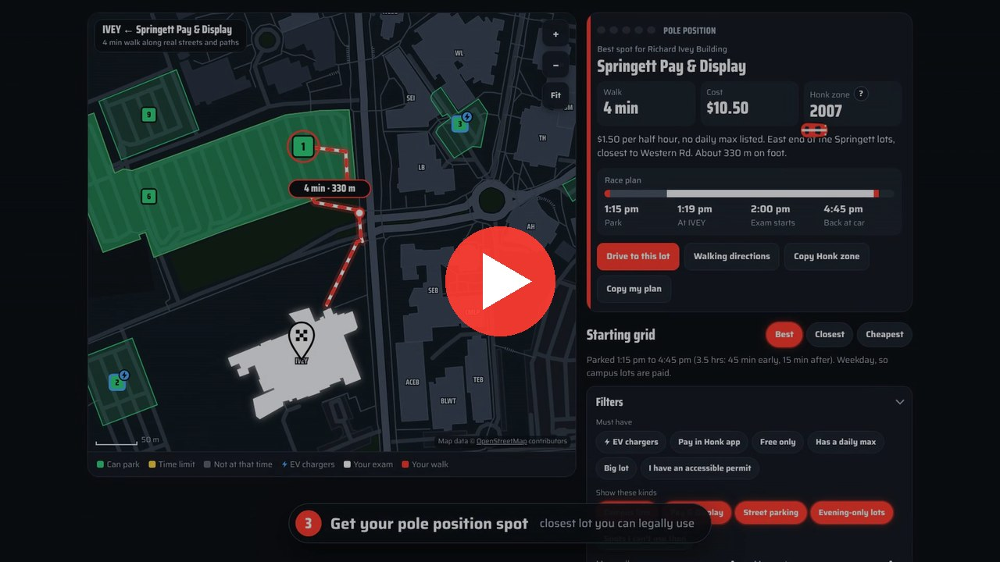
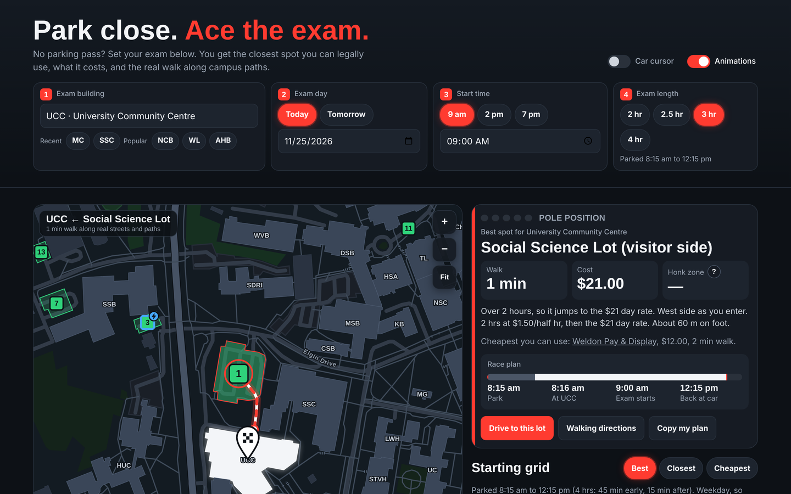
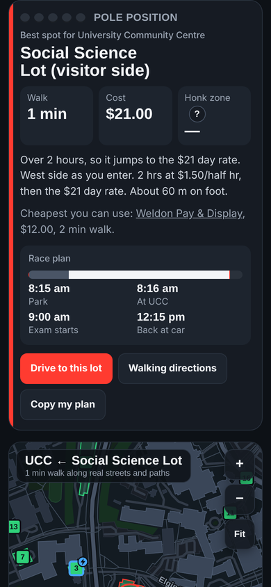

# Western Exam Parking

**Park close. Ace the exam.**

No parking pass? Pick your exam building, day, start time and exam length. The app finds the closest visitor lot or street spot at Western University that you're actually allowed to use at that time, tells you what it'll cost and which Honk zone to pay in, and draws your real walking route on a campus map.

**Live app:** https://akhilganti7.github.io/western-exam-parking/

[](docs/demo.mp4)

**[Watch the demo video](docs/demo.mp4)** (1:40, 1080p)



## Why I built it

During exams, students without a parking permit are left guessing. Which lots allow visitors? Which ones are permit-only until 4 pm? How far is the walk from Huron Flats to UCC? Getting it wrong means a ticket or a late start. This app answers all of that in one screen.

## Features

- **Ranks every visitor spot for your exam.** It checks 38 lots and street spots against your exact parking window (45 min before the exam to 15 min after). It knows "after 4 pm only" lots, the Social Science 2-hour rule, overnight bans, weekends and daily maximums.
- **Real campus map.** Every building, road, footpath, staircase, lot outline, the Thames and green space come from OpenStreetMap, drawn as one zoomable SVG.
- **Real walking routes.** It finds the shortest path over about 10,800 points on the walking network and prefers paths over big roads and stairs. Each building and lot has several possible entrances, and walk times come from real path distance.
- **83 exam buildings.** That's every non-residence code from Western's building list that's on the main-campus map. Search by code or name.
- **Race plan.** Shows when to park, when you'll reach the door, when the exam starts and when you'll be back at the car.
- **Filters.** EV chargers, pay in the Honk app, free only, has a daily max, big lots, accessible permit, max walk, max cost, and which kinds of spots to show (campus lots, pay & display, street, evening-only).
- **One-tap actions.** Drive to the lot, walking directions, copy the Honk zone, copy your whole plan.
- **Works on phone, iPad and desktop.** Pinch, drag and double-tap zoom on touch, scroll zoom and hover tooltips with a mouse. Settings are remembered per device.
- **The fun stuff.** F1 start lights, a supercar cursor with a fire trail, and red glow on taps. Animations and the car cursor can both be switched off, and animations start off for anyone with reduced motion turned on.



## How it works

| Piece | What it does |
|---|---|
| `index.html` | The whole app. Plain HTML, CSS and JavaScript. No framework, no build step. |
| `campus.json` | Map plus routing data (~530 KB). Coordinates are in metres from a campus origin. |
| `scripts/build_campus.py` | Turns raw OpenStreetMap data into `campus.json`. Holds the building table and the lot table (zones, hours, rates). |
| `scripts/geo.py` | Loads the raw data and builds the shapes (Python + shapely). |
| `scripts/fetch_osm.js` | Browser snippet that re-downloads the raw campus data from the OpenStreetMap API. |
| `data/osm_raw.json` | The raw OpenStreetMap pull for the campus area. |

Routing runs in the browser. It uses Dijkstra's algorithm with a binary heap over a compact adjacency list, run once per exam building, which gives the walk distance to every lot at the same time. All 3,000+ building-to-lot routes compute in about a quarter of a second.

## Run it locally

The page loads `campus.json`, so open it through a small local server rather than double-clicking the file:

```bash
python3 -m http.server 8000
# then open http://localhost:8000
```

## Update the data

1. When Western changes zones, hours or rates, edit the `LOTS` table in `scripts/build_campus.py`.
2. To refresh the map, run `scripts/fetch_osm.js` in the browser console on api.openstreetmap.org and save the result as `data/osm_raw.json`.
3. Rebuild:

```bash
pip install shapely
python3 scripts/build_campus.py
```

## Accuracy notes

- Lot zones and hours were checked against Western Parking Services' visitor page on Nov 25, 2026. Posted signs always win.
- A few small lots have no outline in OpenStreetMap (Music Building, Dental Circle, Taylor Library dock, Delaware Hall, Avian, University Drive, Alumni Thompson, Waterloo St). They're placed from Western's written descriptions.
- Some Brescia buildings share one outline, and a few buildings are placed by street address. The app flags these as approximate.
- Daily maximums are only known for some lots. The rest are shown at $1.50 per half hour.
- No live availability yet. Western's lot counts aren't public.

## Ideas for next

- Student "lot full / spots open" reports
- A typical-busyness estimate by time of day
- King's University College lots

## Credits

- Map data © [OpenStreetMap contributors](https://www.openstreetmap.org/copyright), ODbL 1.0
- Parking info from [Western Parking Services](https://www.uwo.ca/parking/)
- Building codes from [Western's building directory](https://www.uwo.ca/westerndir/buildings/abbr/index.html)

Unofficial student project, not affiliated with Western University.

Built by **Akhil Ganti**, Western Engineering. Code under the MIT License (see `LICENSE`).
